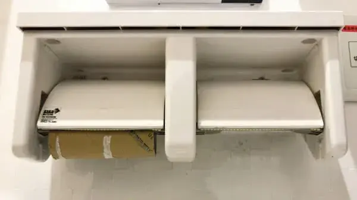

As programmers, we probably use strings more than any other type of data structure. The cross-language String environment is characterized by shared vocabulary and well-established concepts. And it is especially important to follow these established naming conventions when it comes to [null strings](https://web.archive.org/web/20200809121851/https://josjong.com/2017/10/16/null-vs-empty-strings-why-oracle-was-right-and-apple-is-not/) vs empty strings (and blank strings).



With [Apache Commons StringUtils](https://commons.apache.org/proper/commons-lang/apidocs/org/apache/commons/lang3/StringUtils.html#isBlank-java.lang.CharSequence-) and [Hibernate Validator Constraints](https://docs.jboss.org/hibernate/validator/5.4/api/org/hibernate/validator/constraints/NotBlank.html), two popular and [widely adapted](https://mvnrepository.com/artifact/org.apache.commons/commons-lang3/usages) projects established a de facto definition for a blank string:

> “A blank String is a CharSequence that is empty (""), null or whitespace only.”

While recently investigating a bug in one of our systems, I stumbled upon a slight divergent and unexpected string handling in AssertJ, a fluent assertions framework for Java. This [AssertJ misbehaviour](https://github.com/assertj/assertj/issues/1069) has the potential to lead to severe troubles – which is why I consider it to be a bug. As it turns out …  

```java
String s = null;
assertThat(s).isNotBlank();
```

… passes. This is definitely not expected behaviour, since (following the common definition above) a null string is considered to be a blank string and vice versa. So if you're used to Apache Commons StringUtils and Hibernate Validators behaviour, you want to make sure that also your tests expect the correct behaviour.

Do you know further libraries that follow a different blank string definition or if you have a different opinion about all of this, drop me a message [via Mastodon](https://infosec.exchange/@jbspeakr)!