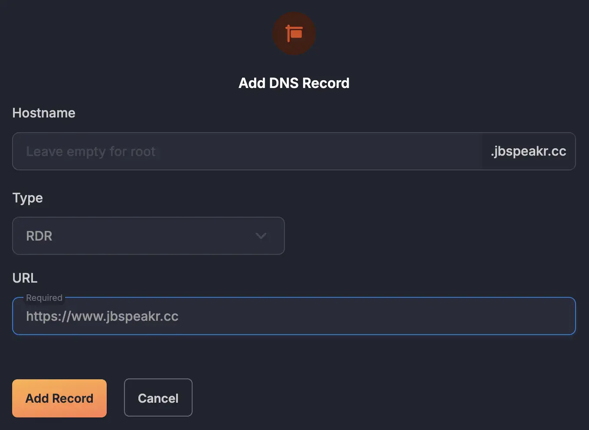
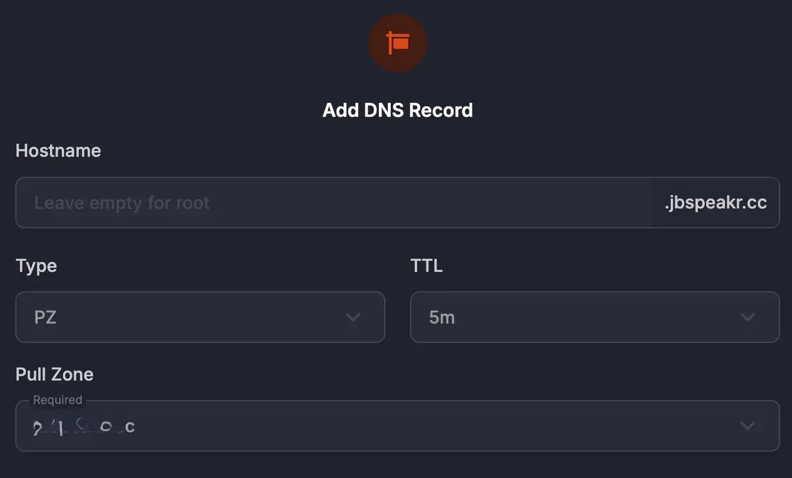
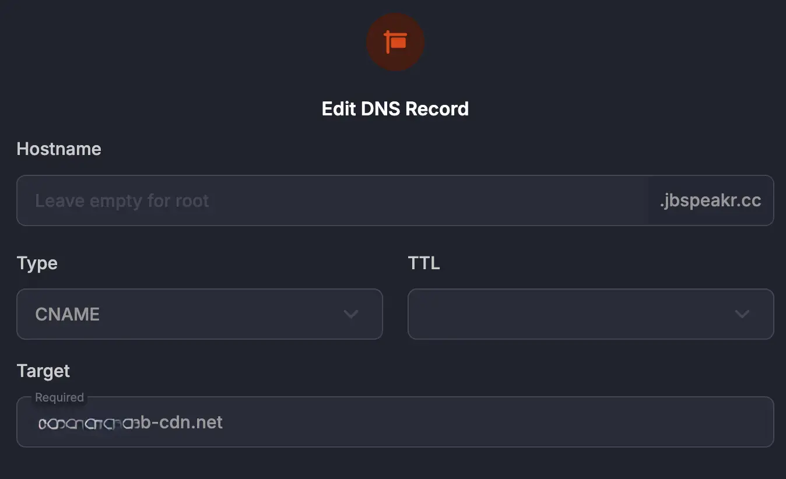
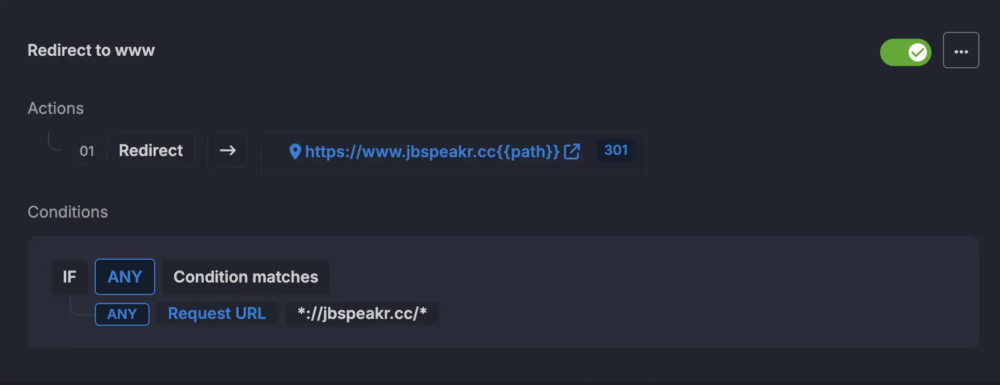

Although technically no longer necessary, the `www` subdomain is deeply ingrained in internet history and user habits. Redirecting root domains (like _janbrennenstuhl.eu_) to its `www` subdomain (_www.janbrennenstuhl.eu_) offers benefits, especially [when using a content delivery network (CDN)](https://bunny.net/blog/how-aname-dns-records-affect-cdn-routing/ "Bunny CDN: How ANAME DNS records affect CDN routing") or caring about search engine optimization (SEO).  

In this article, I share three different approaches to redirect a root domain to its `www` subdomain when using Bunny CDN with Bunny DNS. All three approaches are technically sound and working solutions, returning proper A records for the domain root.

## Option 1: Redirect Record (RDR)

Bunny DNS supports the creation of special redirect records. While the initial resolution happens at the DNS level, Bunny automatically applies HTTP redirects, instructing the browser ultimately to make a request to the redirected location.

Configuring a new redirect record is as simple as heading over to Bunny DNS and choosing `RDR` as record type in the _"Add DNS Record"_ prompt. Setting up a redirect record works as long as you don't already have the hostname registered.

## Option 2: Pull Zone Record (PZ)

A "Pull Zone" in Bunny CDN is a fundamental concept that defines how static assets are delivered using Bunny's network of edge servers.
A `PZ` record is a Bunny-custom, special DNS record type that provides some level of abstraction when glueing a domain to a "Pull Zone". Instead of directly resolving to an IP address, Bunny DNS understands that requests for that particular domain should be directed to its CDN infrastructure associated with the corresponding "Pull Zone".

Configuring a new "Pull Zone" record is as simple as heading over to Bunny DNS and selecting `PZ` as record type in the _"Add DNS Record"_ prompt. Prerequisite is an existing "Pull Zone" that the root domain should point to. The actual HTTP redirect would then be handled by [a dedicated "Edge Rule"](#dedicated-edge-rule).

## Option 3: Canonical Name Record (CNAME)

Finally, Bunny DNS also allows creating `CNAME` records for root domains. This is possible (and also returns an A record) as Bunny transparently performs `CNAME` flattening under the hood. 

Configuring a new canonical name record is as simple as heading over to Bunny DNS and choosing `CNAME` as record type in the _"Add DNS Record"_ prompt. The actual HTTP redirect would then be handled by [a dedicated "Edge Rule"](#dedicated-edge-rule). 

## Dedicated Edge Rule

In case a root domain points to a Bunny CDN "Pull Zone" either by using either a `PZ` or `CNAME` record (Option 2 or Option 3), the actual HTTP redirect (301) needs to be applied using a dedicated "Edge Rule" like this:

| Action         | Value                                 | Status Code
|----------------|---------------------------------------|----|
| Redirect to URL | `https://www.janbrennenstuhl.eu{{path}}` | 301 |

| Condition    | Match | Value         |
|--------------|-------|---------------|
| Request URL  | Any   | `*://janbrennenstuhl.eu/*` |

## Summary

In summary, while the `www` subdomain isn't a technical necessity in the modern web, redirecting root domains to it is a best practice for SEO consistency, technical flexibility, and user experience. It ensures that websites are treated as a single entity by search engines and provides a consistent and potentially more reliable experience for visitors.

Bunny.net DNS supports three different approaches for redirecting a root domain to its `www` subdomain. All result in perfectly fine DNS configs and high-speed resolution when paired with Bunny CDN.
