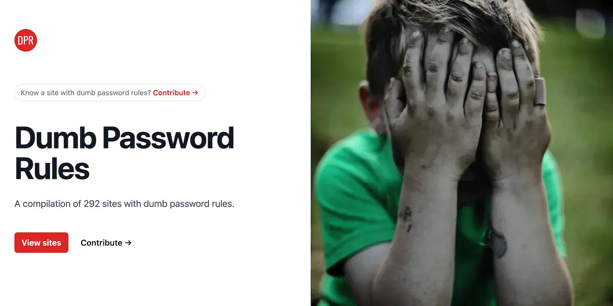

## Importance of Password Policy Best Practices

In today’s digital landscape, both password management and security are more important than ever before. With data breaches and cyberattacks on the rise, it’s crucial that organisations implement strong password policies to protect against credential stuffing, password spaying and related password attacks. However, designing a secure password policy that is both effective and user-friendly can be a challenging task. A password policy that is too complex or difficult to follow introduces friction that will lead to user frustration, while a policy that is too lax can put the organisation and its user accounts at risk.

In this article, I’ll explore the key components of a strong password policy based on state-of-the-art research and provide practical tips for striking a balance between security and usability. Whether you’re a security professional looking to establish a company password policy and guidelines in your organisation, or a web developer who wants to create the ultimate user authentication experience without sacrificing security, this article is for you. So let’s dive in and discover how to design a password policy that’s user-friendly and effective.

## Key Components of a Modern Password Policy

Contrary to common believe and uncountable terribly bad examples of sites leveraging the [dumbest password composition policies](https://dumbpasswordrules.com "A compilation of sites with dumb password rules") in the open wild, security researchers are pretty clear on the key components of a password policy. These ingredients are essential to your password hygiene to be both effective in protecting against unauthorized access and usable for your users:

1. **Minimum-strength** – First and foremost, your password policy should include minimum-strength requirements. This means that passwords must meet certain criteria in order to be considered strong enough to use.
2. **Minimum-length** – The most important characteristic of a strong password is its length. A minimum password length should be long enough to provide a sufficient level of security. Every password policy should enforce strict minimum-length requirements while keeping usability in mind. Longer passwords are more secure passwords.
3. **Blocklist** – Lastly, a blocklist requirement should be included to prevent users from using easily guessable, weak passwords such as `password123`, `12345678` or other common passwords. A blocklist can also be used to prevent users from using passwords that showed up in data breaches, which will help to increase the overall security of your password policy even more.

By combining minimum-strength, minimum-length, and blocklist password requirements together, you can create a password policy that strikes the perfect balance between usability and security. Your users will be able to easily remember their passwords, while also feeling confident that their accounts are secure from unauthorized access. Secure passwords are difficult to guess, and hence much less susceptible to credential stuffing, dictionary attacks or brute force attacks.

## Why Arbitrary Password Policies are Bad

Arbitrary password complexity and composition policies are a common “feature” of many password policies, and they can actually do more harm than good. These complexity requirements often require users to create passwords that meet certain arbitrary requirements, such as including certain character classes like the number of uppercase letters, lowercase letters, numbers, and special characters. However, [research has shown](https://dl.acm.org/doi/pdf/10.1145/3372297.3417882 "Practical Recommendations for Stronger, More Usable
Passwords") that these policies are no security silver bullet and can actually lead to weaker passwords and increased frustration for users:

> "Our experimental results provide the first concrete evidence that character-class requirements should be avoided not only because users tend to find them annoying, but also because they don’t provide substantial bene!t against attackers using state-of-the-art password-cracking tools."

### Stop Password Complexity Requirements!

To illustrate this point, consider the case of a large e-commerce organisation that implemented an arbitrary password composition policy requiring passwords to include at least one uppercase letter, one lowercase letter, one number, and one special character. After implementing this policy, they found that many users were using passwords like `P@ssword1`, `Qwerty1!`, and `W3lcome!`. These passwords were easy to guess and provided little protection against attacks.

Instead of relying on character classes and strict composition policies, it is better to focus on creating strong passwords that are easy for users to come up with and to remember. This core recommendation is also already standardised in the [NIST password guidelines](https://pages.nist.gov/800-63-3/sp800-63b.html "NIST Digital Identity Guidelines on Authentication and Lifecycle Management") within their digital identity guidelines and can be achieved by using techniques like passphrases. Passphrases typically result in longer phrases that are easy to remember but difficult for attackers to guess. By focusing on usability and secure password creation techniques, you can create a password policy that is both effective and user-friendly.

**Sophisticated composition policies should only be leveraged when directly interacting with password managers** – I recently wrote about [How to make your login and sign-up processes password manager friendly!]( "Improving password security: Become Password-Manager friendly!")

## Best Practices for Implementing a Password Security Policy

Now that you understand the key components of a strong and user-friendly password policy, as well as reason for why difficult passwords are not the holy grail, it's important to consider implementation practises. How can you balance security with usability when implementing a password policy? In this section, I'll discuss password strength best practices that will help you with implementing a state-of-the-art password policy that is backed by research. By following these guidelines, you can ensure that your users will create strong passwords without frustration due to arbitrary numbers and special characters enforcement.

### Minimum Password Length

What is the optimal password length for maximum security? Well, as usual the answer depends on your threat model. For organisations protecting high-value accounts without a substantial negative usability impact appetite, research suggests that a well-defined password strength policy should include a composition rule of `1c12+NN10`. This fancy formula transformed into plain-text English basically translates to *"a password including at least one character class (`1C`) of at least 12 characters length (`12`) and not guessable by a neural-network based password cracker in under 10 billion tries (`NN10`)"*.

So from an academic perspective, 12 characters long passwords should be good enough for the majority of services if you can ensure that common crackers would need more than 10 billion tries to guess successfully the same password. However, eight characters seems to still be the more widespread minimum length requirement out there.

How to calculate the guessability of a password will be covered in the next section when I'll describe, how you can implement a low-budget password strength estimation.

### Minimum Password Strength

As you already learned, password policy best practices suggest to grant composition-freedom to the user and to rather focus on estimating how many guesses a neural-network based password cracker would need to find a match. Of course, not everyone of us always has a private neural-network at hand, but there are [budget-friendly alternatives](https://www.usenix.org/system/files/conference/usenixsecurity16/sec16_paper_wheeler.pdf "Low-Budget Password Strength Estimation"). The potentially most popular strength estimator inspired by password crackers is [zxcvbn by Dropbox](https://github.com/dropbox/zxcvbn "Dropbox zxcvbn on Github"):

> "Through pattern matching and conservative estimation, it recognizes and weighs 30k common passwords, common names and surnames according to US census data, popular English words from Wikipedia and US television and movies, and other common patterns like dates, repeats (aaa), sequences (abcd), keyboard patterns (qwertyuiop), and l33t speak."

Most importantly and among other useful characteristics, zxcvbn spits out rather accurate estimates on *"guesses needed to crack the password"*.  Libraries exist for pretty much every programming language and most of them can be extended with custom dictionaries and keyboard layouts.

### Password Blocklists

While common passwords definitely should be banned, other weak or stolen passwords also deserve your attention. Many regular users reuse default passwords across services, as these [5 alarming password reuse studies show]( "5 Alarming Password Reuse Studies"). Credential stuffing attacks using compromised credentials can be considered *"epidemic"* and are currently one of the largest threats for user passwords and accounts.

My recommendation is to perform server-side leaked password checks against a large set of leaked passwords like the [Have I Been Pwned password list](https://haveibeenpwned.com/Passwords). As this list of breached passwords also includes all commonly used secrets and simple passwords, your password blocklist requirement should be fulfilled. Alternatively and likely with a little less friction for your users attached, you can  deny compromised credential pairs (email+secret) by checking for example against the [No More Leaks data set](https://www.politie.nl/onderwerpen/no-more-leaks.html) provided by Dutch authorities. Here you would likely want to incorporate an additional common passwords blocklist, leveraging some fuzzy matching.

Additionally, you definitely want to check for and deny passwords that match the corresponding username.

## Conclusion

Striking a balance between friction and security for account security is possible – even without a sophisticated security awareness training. Moving intellectual workload away from the user and following password security approaches that truly result in measurable defense improvement while offering frictionless experiences to regular users, is the quintessence of the password policy best practices I shared in this article.

As security always depends on your local security risks assessment and threat model while acceptable usability trade-offs pretty much depend on your audience, consider the following quick recap list of *"dos and don'ts"* as general guidance, not as hard requirements:

### 10 Dos & Donts For An Effective Password Strength Policy

- Do apply a minimal length requirement of at least 12 characters.
- Do apply a minimal strength requirement based on guessability indicators.
- Do apply active blocklisting either based on breached data or using fuzzy matching common passwords.
- Do prevent users from using credentials pairs were username equals secret.
- Do allow unicode characters. Character set, character types and classes should be up to the users.
- Do consider disallowing the use of known to be compromised credential pairs.
- Do become password manager friendly. Encouraging users to leverage secret generators is very valuable.
- Do provide multi factor authentication means.
- Don't enforce a maximum length requirement, there is better ways to handle DoS.
- Don't apply composition rules and avoid enforcing specific character classes.
- Don't check for minimum password age or enforce users to regularly change passwords.

As usual, feel free to [drop me message on Mastodon](https://infosec.exchange/@jbspeakr) if you have any suggestions, feedback or comments!

---

## Frequently Asked Questions (FAQ)

### Do password meters discourage users from using complex passwords?

Password meters are visual strength indicators that can help users create strong passwords by providing feedback on the strength of their previous password choices. However, some users may feel discouraged by these meters, especially if they perceive them as too strict or limiting. In some cases, this can lead to users choosing simpler and less secure passwords in order to avoid the frustration of dealing with a password meter.

[Research suggests](https://www.microsoft.com/en-us/research/wp-content/uploads/2016/02/chi13b.pdf), that these meters only make a difference *"when users are forced to change existing passwords"*. Pure visual indicators seem to have no significant effect.

### Should password meters take into account the likelihood of a password being guessed by an attacker?

Yes, your password strength policy should definitely take into consideration how easy it is for malicious actors to guess passwords. How guessable a password is can get directly linked to it overall strength. The actual character composition should not be restricted.

### Should I use a blacklist of commonly used passwords to prevent users from using weak passwords?

Yes, using a blacklist is a good practice to prevent users from using commonly used, formerly breached and reused passwords and hence easy to guess passwords. It is important to note that relying solely on a blacklist is not enough to create a strong password policy. Other best practices such as setting a password length requirement, and implementing multi-factor authentication should also be considered. By using a combination of these measures, you can ensure that your users are creating strong and secure passwords.

### Should I use a password manager to create and store strong passwords?

Yes, and you should educate your users about the benefits of password management tooling. Creating passwords using a password management tool is a highly recommended practice to ensure better security of your online accounts. A password management system can generate long, complex, and unique passwords for each account, reducing the risk of guessing or cracking. Additionally, they can securely store your passwords and automatically fill them in when you visit a website or app, making it easier for you to use a unique and complex password without the need to remember them.

### Is it safe to use the same password for multiple accounts?

In short, no, it is not safe to reuse passwords (and especially credential pairs) across various services. Doing so can lead to disastrous consequences, as it drastically increases your personal account security risk. A security breach on one service can compromise all of your accounts with same passwords. For example, if you use the same password for your email, social media, and e-commerce accounts, a successful data exfiltration on a social media platform will allow malicious actors to also gain access to your other accounts.
