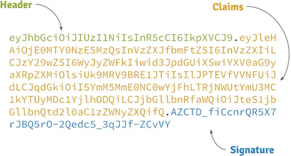

The demand for reliable and effective authentication methods has increased in the modern, distributed, and fast-paced digital world. Stateless authentication solutions are being used by developers and identity providers to deliver secure and scalable single sign-on solutions. JSON Web Token (JWT) are the new fancy kids around the block when it comes to transporting proofs of identity within an untrusted environment like the web. 

## Stateless Sessions Thanks to JSON Web Token

While there are many articles that describe specific aspects, [best practices](https://dev.to/neilmadden/7-best-practices-for-json-web-tokens "7 Best Practices for JSON Web Tokens") or single use-cases of JWTs, the bigger picture and the actual problem definition is often missing. With JWTs gaining in popularity, that missing knowledge of the fundamental ideas of JSON [Web Token]( "Single-Use JWT: The Power of Stateless One Time Token") leads to questions:

- [How to invalidate a JWT?](https://stackoverflow.com/questions/21871029/logout-invalidate-a-jwt)
- [How to prolongate a JWTs expiration date?](https://stackoverflow.com/questions/26739167/jwt-json-web-token-automatic-prolongation-of-expiration)
- [Why should I use JWT, not simple hashed token?](https://stackoverflow.com/questions/41865108/why-should-i-use-jwt-not-simple-hashed-token).

In this article, I describe the true purpose of JWT tokens – **Getting rid of stateful authentication!** – and compare classical, stateful sessions with modern, stateless authentication. Let's start now!

## What is JWT?

### Definition

JSON Web Tokens are a self-contained, URL-safe way of conveying data, unique identifier and claims between two parties in an untrusted environment. They are frequently employed in online applications for the purposes of authentication and authorization of users, transporting proof of authenticity between an identity provider and relying parties.

### Components of JWT tokens

JWTs carry claims that are encoded as JSON object as the payload of a JSON Web Signature (JWS) structure or of a [JSON Web Encryption (JWE)]
( "JWE Token: A Comprehensive Guide") structure, allowing the claims to be encrypted and/or digitally signed in order to protect their integrity. A signed JWT is made up of three components: a header, a payload, and a signature. The header contains metadata, like the type of token and signing algorithm. The claims are stored in the payload and hold details about the particular user and other necessary data. Finally, the signature is used to affirm the token's integrity.

## The Need for Stateless Authentication

Stateless authentication is essential for modern web applications because it eliminates the need for the central authentication server to retain session id and session information. Ideally, this minimizes backend load and enables more effective application scaling. By removing bottlenecks, a decentralized authorization approach is said to simplify system landscape.

### Stateful Authentication

In the old days of the web, authentication was a purely stateful affair. With a centralized overlord entity being responsible for tokens, the world is fairly simple:

- Tokens are issued and stored as stateful session data in a single service for future checking and revocation.
- Clients and resource servers know a single point of truth for token verification and information gathering.

This works rather well in a world of integrated systems, where servers render frontends and dependencies exist on package-level rather than distributed applications.

In a world where applications are composed by a zoo of microservices however, this stateful authentication approach comes with a couple of serious drawbacks:

- No service can operate without a synchronous dependency towards the central token store.
- The token overlord, storing session data, becomes an infrastructural bottleneck and a single point of failure.

Both facts oppose the fundamental ideas of a stateless services landscape. Stateful authentication introduces not just another dependency for all your single-purpose services (network latency!) but also makes them heavily rely on access to it. Without the full session information and data database being available, authorization decisions can't be taken anymore and everything is doomed.

### Stateless Authentication

Stateless token-based authentication describes a system or process, that enables its components to decentrally verify and introspect tokens. This ability to delegate session token verification allows to (partially) get rid of the direct coupling to a central session data database and in that way enables state transfer for authentication proves. The benefits are clear:

- Less latency through service-local, decentralized token verification and authorization decisions.
- Increased resilience through less network overhead.

Stateless authentication is also able to absolve you from the need to keep track of issued tokens and for that reason removes state (and hence reduces storage) dependencies from your system. The antiquated, heavy-weighted token overlord solution converges to [to yet another microservice](https://auth0.com/blog/stateless-auth-for-stateful-minds/ "Auth0: Stateless Sessions for Stateful Minds") being mainly responsible for authentication and token issuing.

### Stateful vs. Stateless

Today, an authentication system has to support stateless architecture service landscapes mainly characterized by fleets of thousands of services and millions of actors. Central bottlenecks by design become an operational burden. However there are no silver bullets, JWTs ain’t Swiss army knifes and also stateful authentication has its righteous place. 

If you really need a central authentication system to persist session data or if you simply don't trust people [or library source code](https://www.chosenplaintext.ca/2015/03/31/jwt-algorithm-confusion.html "Critical vulnerabilities in JSON Web Token libraries") to correctly verify session information in your JWTs, a stateful overlord approach is still the way to go and there is nothing wrong about it.

## How JWT Enables Stateless Authentication

### Token-based authentication

Stateless authentication get enabled through the use of stateless tokens (JWT). The authentication server generates these token, which are self-contained and carry all necessary details about the session and the user. In order to avoid the backend from having to keep track of any session ID and session data, the client stores this token and includes it in subsequent requests.

### JSON Web Signature (JWS)

To guarantee the authenticity and integrity of the token, JWT session token must always use JWS. Because the private key material used to create this digital signature is only known to the server, it prevents unauthorized modification of the token.

## Pros and Cons of Stateless Authentication with JWT

### Advantages

- Scalability: Stateless authentication removes architectural bottlenecks, can reduce server load and allows for easier horizontal scaling.
- Performance: Less server overhead means faster response times.
- Simplified architecture: No need to manage sessions stored server-side.

### Disadvantages

- Token size: Due to their metadata overhead, JWTs are generally larger than traditional session cookies, increasing bandwidth usage.
- Token theft: If a token is stolen, it can be used until it expires, posing a security risk.

## Understanding JWT Workflow

One popular way to achieve stateless authentication is defined in [RFC 7523](https://tools.ietf.org/html/rfc7523 "JSON Web Token (JWT) Profile for OAuth 2.0 Client Authentication and Authorization Grants") and leverages the OAuth 2.0 Authorization Framework ([RFC 6749](https://tools.ietf.org/html/rfc6749 "The OAuth 2.0 Authorization Framework")) by combining it with signed JWT ([RFC 7519](https://tools.ietf.org/html/rfc7519 "JSON Web Token (JWT)"), [RFC 7515](https://tools.ietf.org/html/rfc7515 "JSON Web Signature (JWS)")). Instead of storing the token-to-principal relationship in a database in a stateful manner, cryptographic signatures allow decentralized clients to securely store and grant access, without need to retrieve data from a central system for every inbound request.

Stateless tokens are also a key component of OpenID Connect (OIDC), an identity layer solution built on top of the OAuth 2.0 protocol. OpenID Connect specifies industry-standard flows that allow clients to access basic profile information about the end-user in an interoperable way and to confirm the end-user's identity based on the authentication carried out by an authorization server.

> “Using a JWT as a bearer for authorization, you can statelessly verify if the user is authenticated by simply checking if the expiration in the payload hasn't expired and if the signature is valid.”
> — <cite><a href="http://jonatan.nilsson.is/stateless-tokens-with-jwt/" title="Stateless tokens with JWT">Jonatan Nilsson</a></cite>

With tokens not being opaque but locally introspectable, clients can retrieve addition information about the corresponding identity directly from the token without the need of calling another remote API. The following is a simplified, non-normative lifecycle example of a stateless JWT.

### Token Creation

1. The user submits their credentials (e.g., username and password) to the authentication system.
2. The server authenticates the actor by verifying the credentials and generates a JWT containing user-related claims.
3. The server signs the token using a private key and returns it to the client side.

### Token Verification

1. The client includes the JWT as bearer token within the Authorization header in subsequent requests.
2. The resource server verifies the token's signature and validates the claims.
3. If the token is valid and authorization successful, the resource server processes the request and returns the appropriate response.

### Token Expiration

1. JWTs typically include an expiration time to limit their validity.
2. Once the token expires, the client must request a new token by re-authenticating with the authorization server.

## Use Cases for JWT

- Authorization: Securely authorize actors based on user claims like roles and permissions without relying on server-side sessions.
- Information Exchange: Securely transmit information between parties in untrusted environments.

## Security Concerns & Considerations

- Token storage: Store tokens in a secure location on the client side, such HttpOnly cookies or other safe places.
- Transport security: Use HTTPS to protect tokens from being intercepted during transmission.
- Token revocation: By design, JWTs are not remotely revokable. To revoke tokens in case of token theft or user logout requires, a stateful mechanism to be in place – which sort of [counters the stateless approach](https://web.archive.org/web/20241106205450/https://www.dinochiesa.net/?p=1388 "Revoking or Blacklisting JWT").
- Token update: There is no way of altering an issued JWT. Prolongating its expiration date for example is not possible.

## Best Practices for JWT Implementation

- **Use short expiration times**: Limit the window of opportunity for token theft.
- **Rotate private keys**: Regularly update the signing key to mitigate risks associated with key compromise.
- **Validate tokens**: Before processing requests, always check the tokens validity on the authorizing backend.

## Conclusion

In modern web applications, JWTs offer a reliable and adaptable stateless authentication method. Developers may create secure, scalable, and effective apps that satisfy the requirements of today's digital ecosystem by utilizing their advantages and following best practices.

## FAQs

### What is the main purpose of using JWT in stateless authentication?

The major goal is enhanced scalability and performance by securely authorizing users without relying on server-side sessions.

### How can I prevent JWT theft?

Tokens must be stored securely on the client side and transmitted encrypted using HTTPS. If stateful revocation procedures are not implemented, tokens should have a short expiration time.

### Can I use JWT for authorization as well as authentication?

JWTs can function as bearer tokens. Authorization decisions can be made either purely on token validity or take into consideration claims carried by the token.

### Do I need to store JWT session data in a database?

No, JWTs are self-contained and do not require server-side storage. Actually that would be an anti-pattern.

### How do I handle JWT expiration?

Implement a mechanism for clients to request a new token when the existing one expires. OAuth 2.0 for example distinguishes between access token and refresh token and defines protocols on how to continuously refresh tokens without need to actively re-authenticate the user.
