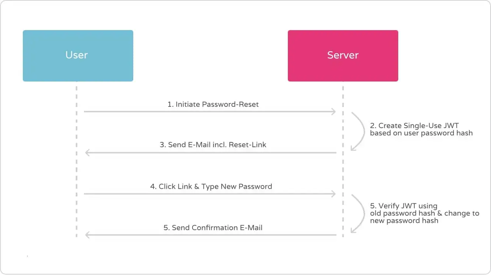

## Understanding JSON Web Tokens

Welcome to the future of authentication! In a world where digital security is paramount, the need for robust and reliable authentication methods has never been more crucial. [JSON Web Tokens]( "More about JWTs") are the new and fancy de-facto standard in the web. JWTs are the tool of choice when it comes to authentication in an stateless environment. That has two direct implications:

1. You should definitely go and get some proper introduction on [the purpose of JSON Web Tokens]( "Stateful vs Stateless Authentication") and some insights on how they work. It's worth to know as JWTs are widely used for e.g. authentication against REST-APIs.
2. As JWTs are still comparably fresh, hot and simply fancy in contrast to traditional bearer token, some people think they are some kind of holy grail and can be used to solve every possible use-case … and guess what: They are not!

In this article, I will dive into the benefits of single-use JWTs, how they work, and best practices for implementing them in your application. Get ready to unlock the full potential of stateless authentication with single-use JWTs!

### What are JSON Web Tokens?

JSON Web Tokens are an industry standard method for exchanging claims securely between two parties. They are defined as an open standard in [RFC 7519](https://datatracker.ietf.org/doc/html/rfc7519) but only become truly powerful in combination with [RFC 7515](https://datatracker.ietf.org/doc/html/rfc7515), which describes JSON Web Signatures (JWS). In combination, the two standards allow the creation of a cryptographically signed json object that carries state and can get verified, which basically means that you have means to ensure that a JWT is valid and created by someone you have faith in before you trust it.

Being self-contained, stateless and signed, JWT tokens allow you to leverage so-called [stateless authentication]( "Stateless Authentication, the purpose of JWT"), mostly in form of bearer tokens within an authorization header (access token), issued by an authorization server in context of OAuth 2.0 or OpenID Connect (OIDC).

But there are further information exchange use cases for standardised, signed tokens that can carry state between some other client side and a server or two servers. One example, I saw being discussed in the open wild and also within companies, is to use a JWT token as one-time token (OTT).

### The Power of JSON Web Token

While not being a Swiss army knife, the power of JSON Web Tokens lies in their ability to unlock a multitude of benefits especially for authorization servers, identity provider servers and system reliability. From my point of view, the key features that make JWTs a force to be reckoned with in the world of digital security, is their support of stateless architecture. Unlike traditional session-based authentication mechanisms, JWTs are stateless by design. This means that servers do not necessarily need to store any session-related information in their database, resulting in improved scalability and reduced server-side complexity. 

Another side-effect of the general hype around these stateless tokens, is their interoperability. JWTs have gained widespread adoption and support across different programming languages, frameworks, and platforms. Every niche has their own JWT library. This interoperability ensures seamless integration into existing systems and promotes interoperability between various components of a distributed application. JWT token basically standardised the data format of access tokens or session token. 

## What Is a One Time Use Token?

A One Time Use Token, also known as a single-use token, is a unique and disposable identifier that is generated for a specific transaction or interaction. Unlike traditional tokens or credentials that can be reused multiple times, a one-time use token serves a singular purpose and becomes invalidated or expired after its initial use.

The primary purpose of a one-time use token is to enhance security and reduce the risk of unauthorized access or fraudulent activities. By limiting the token's usability to a single instance, it significantly mitigates the chances of interception, replay attacks, or unauthorized reuse. This makes one-time use tokens an invaluable tool in various domains, including authentication systems, payment processing, and secure communication protocols.

### Advantages of Single-Use Token Validation

One-time use tokens are typically generated through a cryptographic algorithm or hash function, ensuring their uniqueness and tamper-resistant properties. Once generated, the token is associated with a specific transaction or user session, providing a temporary authorization credential that grants access to protected resources or validates an action. Once it fulfils its intended purpose, the token expires and becomes invalid, ensuring that any subsequent attempts to use or manipulate it are rendered ineffective.

The advantages of one-time use tokens extend beyond just security. They also offer enhanced traceability and auditability, as each token can be easily tracked and linked to a specific event or transaction. This attribute becomes particularly valuable in scenarios where accountability and compliance are crucial, such as financial transactions or regulatory environments.

## Implementing One-Time JWT Token

Let's talk about use-cases: Imagine you have a setup based on OAuth 2.0 that uses signed JWTs as bearer tokens for user-auth. Further imagine you want to provide [account recovery via password-reset]( "Account Recovery & Password Resets") by email with confirmation-link included. For that confirmation-link we would then need to have some kind of proof attached as query param to the URI. As the password-reset should work only once, the token is required to get invalided after successful usage. Hence, we would need the shared secret to have OTT characteristics.

One solution could be a storage holding issued tokens and validity information. Every incoming password-reset request for the protected resource that the reset-link is targeting would then be authorized by the receiving web application against that central list. This so-called *"stateful approach"* introduces a single point of truth. The token storage becomes the central bottleneck. 

It would be great if another solution could leverage existing concepts. For example our stateless authentication system with its ability to create, sign and verify JWTs …

### Generating and Validating Tokens

The solution for our problem is actually straightforward as it is based on a simple trick. Although we can't (and don't want to) alter issued JWTs, our resource server is still the master of verification. We just need to look at JSON Web Token verification from another angle – for example by using app-state as input secret for the HMAC algorithm during JWS issuing! 

To stay in the example use case of account recovery that means, that using the users current password hash as secret key for the signing algorithm guarantees single-usage of every issued reset token. This is because the salted hash naturally always changes with a new input, which at the same time concludes the password-reset procedure successfully. There is no way the same token can pass verification twice. The signature checks in case of a  replay of signed tokens would always fail. 

Using private, server-side state, sensitive data that changes as an outcome of a business operation, to sign a JSON Web Token that is used to authorize the very same business operation, results in the JWT effectively becoming a one-time token.

### User Experience and Usability Challenges

Especially in the context of email based password reset capabilities there is however technical risk attached: One of the drawbacks of JSON Web Tokens (JWTs) is their larger payload size compared to other token type. Since signed JWTs store information within the token itself, including metadata and a massive digital signature, the size can grow significantly. This can have implications, especially in scenarios where tokens are transmitted as query parameters. 

Browsers impose a de-facto limit of 2000 characters for URIs and also email providers or clients appears to also struggle with large URIs. As many email links already include a zoo of e.g. tracking IDs, you definitely want to think and test twice before deciding to put a JWT into a query param.

### Security Issues & Risks

Besides the regular security issues of JSON Web Token that largely resided with insufficient implementations on the signature verification, combining JWT and OTT characteristics does not introduce any new attack vectors.  Both, authorization server and resource server have to perform the same tasks, whether they implement JWT or not.

## Embracing the Future of Stateless One-Time Tokens

So let's sum up our findings on how to implement single-use tokens based on JWT:

1. There is no need to setup some kind of token-registry storage. This would counter the idea of stateless tokens anyway.
2. Instead, compose signature secrets based on values that change after each token usage. In other words: **Turn app state into HMAC-keys to guarantee one-time use of JWTs!**

Although in theory, this might also work for other use-cases like email verification or account confirmation, my thoughts took shape while reasoning about account recovery approaches. Furthermore, I do believe this to be a rather academical exercise and that we won't see this getting widely adapted in the open wild.

What do you think? Let me know [via Mastodon](https://infosec.exchange/@jbspeakr) and also make sure to share your exotic use cases for JSON web tokens and one-time token approaches with me. I also appreciate feedback and further discussion, thanks!
